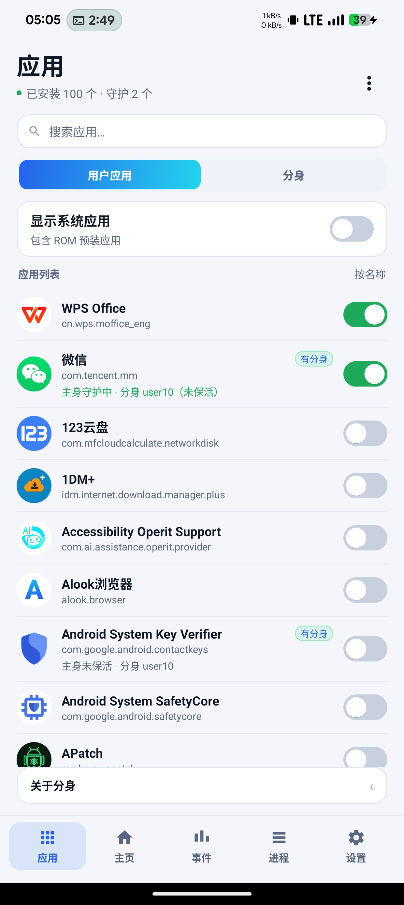
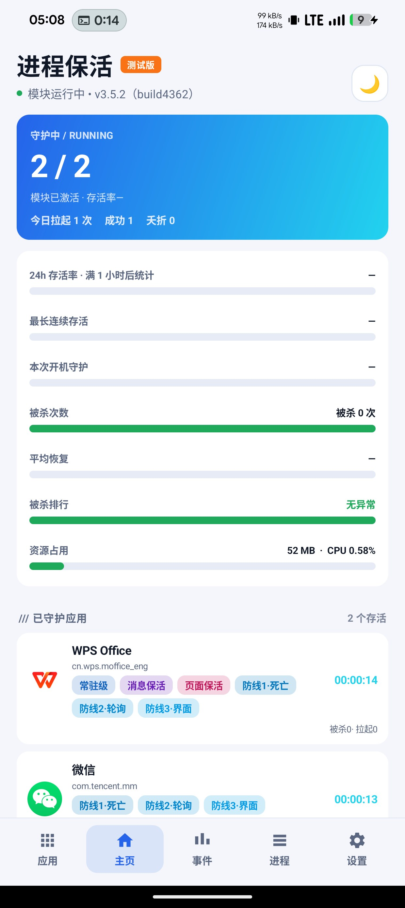
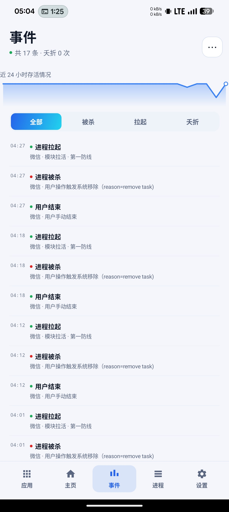
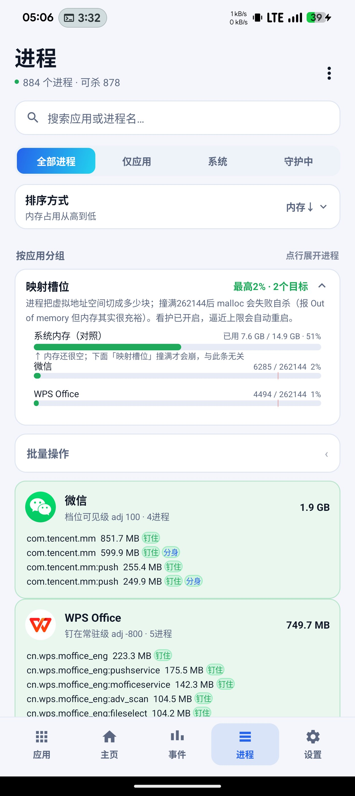
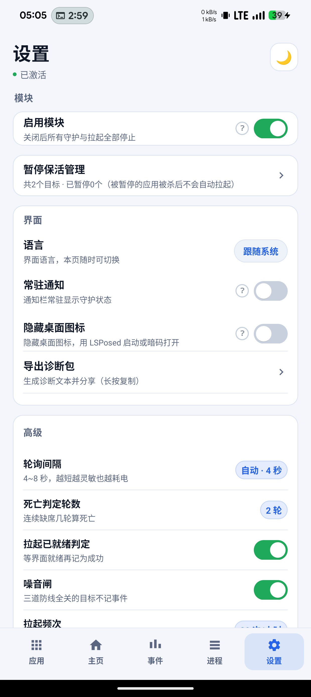

基于 **LSPosed / Xposed** 的 Android 后台保活模块，防止你勾选的应用被系统杀进程（主要面向 LineageOS / AOSP 系）。

简体中文 | [English](https://github.com/Xposed-Modules-Repo/io.github.guys222.processkeepalive/blob/main/README_en.md)

# 进程保活（ProcessKeepAlive）

> 🐛 **问题反馈**：本仓库（LSPosed 收录库）按官方策略未开放 Issues，**请到公开反馈仓库
> [ProcessKeepAlive-Issues](https://github.com/Guys222/ProcessKeepAlive-Issues) 提问或反馈**
> （源码仓库私有维护，不对外开放；Issues 提 Bug，Discussions 提问）。

> ⚠️ 仅限个人设备、自己安装的应用使用。保活会让应用持续占用内存与电量，请勿用于追踪、监控他人设备。

## 安装

在 LSPosed Manager 中搜索「进程保活」安装，或从
[Releases](https://github.com/Xposed-Modules-Repo/io.github.guys222.processkeepalive/releases) 下载最新 APK
（如 `PKA-v3.5.2-build4363.apk`，已用项目专用 keystore 签名，可直接覆盖安装）。

每个版本都发**两个包**，功能完全一样：

- `PKA-v<版本>-build<号>.apk` —— 正式包，装给所有人；
- `PKA-v<版本>-build<号>-debug.apk` —— 测试包，**遇到问题请装这个**：白屏、卡死（ANR）、拉不起来时
  它会自动把现场存进 `/data/system/pka_hook.log`，导诊断包时一并带走。两者同签名，可互覆盖。

**装完必须重启手机** —— 钩子跑在系统框架里，不重启加载的还是旧代码。

启用后**必须**在 LSPosed 中把作用域勾上「**系统框架（android）**」——所有钩子都注入
`system_server`，不勾这一项模块不工作。

> 可选：同时勾选「本模块」仅用于 App 主页「模块激活状态」的实时检测，不勾不影响保活。

## 界面

底部五页导航：**应用 / 主页 / 事件 / 进程 / 设置**，支持深色 / 浅色 / 跟随系统三种主题，附带 4×1 桌面小部件。

| 应用 | 主页 | 事件 |
| --- | --- | --- |
|  |  |  |

| 进程 | 设置 |
| --- | --- |
|  |  |

- **应用** — 搜索与勾选目标应用，每个应用显示真实存活时长与「被杀 / 拉起」次数；分身（多开）应用单独标识
- **主页** — 模块激活状态、Bento 概览（守护中 / 运行中 / 消息保活）、24 小时存活曲线（可下钻到单个应用）、本次开机守护与被杀排行
- **事件** — 守护事件时间线（被杀 / 拉起 / 夭折 / 用户结束），带时间戳与类型徽标；顶部可按类型筛选、长按刷新按钮把本次开机全部事件**导出为 CSV**，另有近 24 小时存活折线
- **进程** — system_server 视角的实时进程看板（pid / 状态 / oom_adj / RSS / 运行时长），含内存映射槽位看护，支持杀进程与导出快照
- **设置** — 各保活能力开关、优先级档位、常驻通知、配置备份与恢复、导出诊断包

## 它能做什么

| 能力 | 说明 | 默认 |
| --- | --- | --- |
| 降低 OOM Adj | 把目标进程优先级压低到「可见级」，LMK 不优先杀它 | 开 |
| 阻止强制停止 | 拦截 `forceStopPackage`，设置里的「强行停止」失效（**保进程**） | 开 |
| 阻止后台杀死 | 拦截 `killBackgroundProcesses`（**保进程**） | 开 |
| 防止系统冻结 | 拦截 app freezer，避免进程被冻结后直接 SIGKILL（**保进程**） | 开 |
| 强力模式 | 拦截 `ProcessRecord.kill` / `killPackageProcessesLocked`（**保进程·激进**） | 关 |
| 常驻实验 | 把目标进程标记为 `persistent`，被杀后自动重启（**保进程·兜底**） | 关 |
| 消息保活 | Doze/Standby 豁免 + 伪装前台防断连（**保进程**，顺带让界面不被回收） | 关 |
| 页面保活 | 把进程状态伪装为 `BOUND_TOP` / `FOREGROUND_SERVICE`，系统不回收其 Activity（**保页面**） | 关 |
| 开机自启动 | 重启后自动拉起已勾选的应用（system_server 内拉起，绕过后台限制） | 关 |
| 三道防线 | 进程死亡后按「服务 → Provider → 界面」依次尝试拉回，界面拉起后自动退回后台 | 开 |

> **「保进程」和「保页面」是两件事。**
> 除「页面保活」外，所有开关只保证**进程不被杀**——应用回到前台时，界面（Activity）仍可能被
> 系统回收并重新加载，这是 Android 的正常行为。
>
> 「页面保活」通过把进程状态伪装成前台（`BOUND_TOP` / `FOREGROUND_SERVICE`）来阻止系统回收 Activity，**只对"由系统主动回收页面"
> 的 ROM 有效**。若应用自己主动调用了 `finish()` 重建界面（如部分 App 检测到后台超时后主动
> 重启自己的页面），框架层面拦不住，此时页面依然会重载。页面能否完整恢复也取决于应用自身
> 有没有保存状态。

## 原理（钩子点）

全部注入 `system_server`（包名 `android`）：

- `ActivityManagerService.forceStopPackage`
- `ActivityManagerService.killBackgroundProcesses`
- `ActivityManagerService.killPackageProcessesLocked`
- `OomAdjuster.computeOomAdjLocked`（Android 11+；老版本回退 `updateOomAdjLocked`）
- `ProcessRecord.kill`
- `ActivityManagerService.newProcessRecordLocked`（常驻实验）
- `ActivityManagerService.finishBooting`（开机自启动）

OOM Adj 只「下调、不上调」：绝不会把正在前台运行的进程优先级调高，避免误伤。

## 重要提示

- **保活不影响应用更新**（v3.3.0 起）：安装/更新前系统必然调用 `forceStopPackage`，
  模块已对安装、替换、卸载以及 root/shell 调用自动放行，不会再出现「保活后装不上新版」。
- **LineageOS 本身不像 MIUI/ColorOS 那样激进杀后台**，本模块主要解决「内存紧张时被 LMK 杀掉」
  和「被强行停止」两类场景，效果不像在国产 ROM 上那么戏剧化。
- **常驻实验有风险**：可能让应用在卸载/更新时异常、崩溃后无限重启、增加耗电，默认关闭。
- **常驻通知需要通知权限**：Android 13+ 首次开启会申请 `POST_NOTIFICATIONS`。
- **Doze/待机**：对开启「消息保活」的应用会自动豁免省电白名单与 App Standby 限流。
- 修改任意设置后约 30 秒自动热刷新，无需重启；长时间不生效再重启系统。

## 验证

```bash
adb logcat -s ProcessKeepAlive                 # 查看模块日志
adb shell "ps -A | grep com.example.app"       # 确认进程存活
adb shell "cat /proc/<pid>/oom_score_adj"      # 值越低越不容易被杀
```

## 更新日志

### v3.5.2（build 4363）

**修复白屏** —— 页面保活会拦下「页面切后台」「页面被结束」，前提是「记录还在，页面就能原样回来」。
但进程被杀之后，这条记录就只剩空壳：记录还挂在系统里，却没有任何进程能往它的窗口里画东西。
用户点图标时系统复用的正是它 —— 窗口建出来、内容画不出来，**于是白屏**，直到应用自己重建一遍
（就是那个「白屏然后首页刷新」）。没被杀过的应用不会这样，因为记录不是空壳。
现在页面保活只保**活着的进程**的页面，宿主进程一旦不在，记录一律放行销毁。

**修复「补拉之后应用赖在前台不走」** —— 上一版的保护条件里有一条「界面已就绪就跳过」，
而等待界面就绪的循环恰恰是「就绪才跳出」，同一条判据在同一次调用里恒为真，
于是界面一画出来就永远不送回后台。现在只看两件只有用户才能产生的事实：
拉起**之前**它是否已在前台、它出现**之后**用户是否碰过屏幕。

**第 4 路拉起（AMS 直拉）** —— 在 Android 17 上一直空转：方法找错了类（`startProcessLocked`
在 `ProcessList` 上），参数也是瞎填的（引用类型全塞 null，必然调不通）。现在按真实签名填参；
本机确实不支持时只记一行「不适用」，不再每几秒重试。

**日志体积** —— 防冻分档原来每 20 次一条、每条罗列上百个包名，把日志撑到几 MB。
现在按原因汇总、10 分钟一条。

**debug 包新增「卡死」抓现场** —— 之前三个自动抓点全是为白屏选的，应用 ANR（卡死）时一个都不触发。
现在挂了 `AMS.appNotResponding`，目标应用一 ANR 就自动存主线程栈 / CPU / 内存 / 系统 ANR 记录。

### v3.5.0（build 4232）
**新增功能**

- **三防线按应用覆盖**：开机拉起 / 死亡补拉 / 轮询兜底现在可以逐个应用单独开关，未单独设过的继续跟随全局默认值。分身与主包完全独立，互不影响
- **拉起后夭折事件**：拉起指令发出后复查途中再次死亡的，事件流会单独记一条「拉起后夭折 · 第X防线（第N次）」，不再静默失败
- **轮询间隔可调**：轮询 4 / 6 / 8 秒四档，越短越灵敏也越耗电
- **死亡判定轮数可调**：连续缺席 1~5 轮算死亡，默认 2 轮；带常驻标记的托底 / 核心级目标固定 1 轮
- **噪音闸**：三道防线全关的目标不再产生事件记录，事件流只保留真正需要关注的
- **「起来就死」自动静音**：连续 3 次拉起后存活不足 30 秒，暂停记录该类事件；恢复正常存活后自动解除
- **守护事件独立成页**：事件从主页底部拆出成独立页签，支持按类型筛选
- **终止免拉永久生效**：手动划掉卡片 / 强停 / 一键清理后不再补拉，不会在 60 秒后自己又拉回来；仅当你主动重新打开该应用才恢复。事件流会记一条「暂停补拉」留痕

**Bug 修复**

- **主页显示拉起成功、点开是冷启动**：原先判定标准是「包内有任意进程存活」，而通过 Provider 拉起时经常只有 `:remote`、`.fp` 这类子进程起来，主进程并未启动却被记为成功。现在改为主进程为准，仅子进程存活记为「拉起不完整」并继续补拉
- **拉起后闪一下就没、之后无人处理**：原先拉起指令发出瞬间就记成功，冷启动那几秒的空窗里被杀没有任何人察觉。现在指令发出只登记待确认，由三轮复查（5s / 8s / 12s）确认主进程连续存活后才最终落成功
- **被杀一次后必须手动点桌面才恢复**：同一原因，主进程不存在时收不到死亡回调，第一防线静默失效。随主进程判定一并修复，链路不再中断
- **给分身关掉的防线被主包设置覆盖**：分身键解析不到 userId 时会回退去读主包配置，导致分身的独立设置被主包覆盖。现在两者完全独立，不做回退
- **暂停保活实际不生效**：被暂停的包此前只是从列表里消失，模块侧照常补拉、拦截、记事件。现在下发时直接剔除，模块读不到就不动它
- **手动划掉的目标 60 秒后又被拉回来**：旧实现把用户终止豁免限为 60 秒，超时自动撤销。现在豁免永久有效，只有你重新打开应用才恢复补拉

**界面优化**

- 整体重新排版，开关开启 / 关闭状态的视觉区分加强
- 设置页分区行、说明文字、问号组件的对齐与间距统一
- 暂停保活管理改为弹窗，列表补上应用图标、状态副标题与分隔线

### v3.4.5（build 4095）

**新增功能**

- **三个拉起开关拆分**：开机拉起 / 死后补拉（第一防线）/ 轮询兜底（第二防线）各自独立，可单独关闭。全部关闭即「只保进程、不自动拉起」——想把拉起交给系统或第三方调度器的用户，现在可以直接这么配
- **总开关语义收窄**：改为纯模块主开关，不再与拉起行为绑定
- **界面兜底拉起后自动退回后台**：第三路拉起目标应用后不再顶在前台，拉起完立即送回后台
- **路径自探测与缓存**：开机自动探测 AMS / ATMS / RootWindowContainer / Task 送回后台的可用路径并缓存，换 ROM 不用重编译
- **副作用告知弹窗**：开启界面兜底前先说明「会短暂顶前台」这一代价，确认后才生效；取消 / 返回键 / 点空白处均回滚，不会误开启
- **诊断日志开关化**：默认关闭，排查时按需开启
- **保活自测动态进度**：自测对话框改为带阶段文字与进度条，实时显示已观察秒数
- **补拉失败也记守护事件**：UI 时间线能看到「模块拉活失败 · 第X防线」，不再是静默失败

**Bug 修复**

- **冷启动补拉失效**：相关实例仅在 forceStop 钩子中赋值，冷启动时为 null，导致刚开机时第一防线不工作；改为按需解析并缓存
- **送回后台反复失败**：先后排除三条不可用的系统私有路径，最终确认 `Task.moveTaskToBack(Task)` 可用
- **微信等常驻应用开机事件丢失**：判据从「用户是否勾选」改为「进程是否真带常驻标记」，不再误判
- **Android 17 上部分兼容路径必然失败**：该版本系统内部已合并两个管理服务为同一类，改为直接从本体取字段（低版本仍保留原路径）
- **字段查找误命中内部类**：按类型名匹配会撞上 Handler 内部类，已排除并增加兜底扫描
- **弹窗确认按钮被顶出屏幕**：恢复正常显示，滚动限高生效
- **场景模板按钮视觉下沉**：两态几何对齐

### v3.4.4（build 4033）

**保活**

- 再次修复「按 Home 回桌面后被自动弹回应用」：撤掉阻止界面状态进入 STOPPING 的拦截
- 页面保活只保留 addToStopping 一层：界面状态可正常走完，系统不销毁页面，回来仍是原页面
- 状态与真实可见性保持一致，不再出现「桌面刚出来就被顶掉」

### v3.4.4（build 4031）

**保活**

- 修复「按 Home 回桌面后自动跳回被保活应用」：撤回对 PAUSED（失去焦点）与窗口可见性的拦截，页面保活只保留「不进入 STOPPING」
- 效果：可以正常切到桌面，切回来仍是原页面、不重新加载，后台任务不中断

**说明文案**

- 设置页「保活环境」改为「通知与环境」，开头说明这些项只影响通知显示与开机自启，防杀与补拉在系统进程内运行、不依赖它们
- 逐项补充边界：通知权限、电池优化、常驻通知服务分别影响什么、不影响什么
- 自启动由「不适用」改为「需确认」
- 底部结论改为「以上均已就绪」，并注明未通过项不影响防杀与补拉

### v3.4.4（build 4030）

**稳定性**

- 修复开机、切换应用时的系统卡顿与「没有响应」提示：字段查找加入成功/失败缓存，同一字段只反射一次；进程启动标识改用真实存在的字段
- 保活设置关闭后不再被清空，重新开启恢复上次配置；分身恢复自身配置
- 高频的进程结束记录接入缓存，非保活目标不再重复解析

**诊断**

- 运行日志改为落文件，单文件 8MB、轮转保留一份，合计约 16MB；诊断包附带末尾约 2MB
- 每次开机写入分隔行与版本号，便于定位问题所属的开机区间
- 崩溃现场改为提取主线程，不再只取文件末尾
- 系统高负载时仅跳过调用栈采集，日志照常记录

### v3.4.4（build 4028）

**稳定性**

- 修复「批量结束进程」拦截返回空值导致的系统进程异常（严重时整机重启）
- 拦截统一按方法声明类型返回值，杜绝同类拆箱异常
- 非保活进程不再逐个解析包名与 uid，系统调整优先级时的开销大幅下降
- 按 CPU 核数与内存分档，性能有限的设备自动放慢巡检节奏

**保活**

- 页面保活扩展到暂停、停止、窗口不可见三条路径，应用持续认为自己在前后台切换后回到原位，补充状态机路径
- 新增进程重要性查询伪造（getMyMemoryState / getRunningAppProcesses）

**推送**

- 省电白名单 + 待机状态置为活跃，息屏久置消息不延迟
- 系统「是否限制该应用」的查询一律答复未限制，避免应用误判后主动断连

**网络**

- 卡死判定改为流量状态机：先确认正在传输，归零约 36 秒后自动恢复
- WiFi 高性能锁改为按流量持有（原先依赖连接表，多数机型上从未生效）

**拉起**

- 优先选择无副作用的服务，备份/迁移/媒体类仅在别无选择时回退
- 更新与安装期间开窗口让路，不再与安装流程冲突

**诊断**

- 诊断包只带本模块日志，体积从数 MB 降到数百 KB
- 自动附带系统崩溃现场，并标注是否包含本模块
- 文件名带版本与导出时间

### v3.4.4（build 4027）

**后台断网防护重做**

- 防火墙相关钩子此前未生效：类名、方法名与 AOSP 实际实现不符，规则从未被拦下。现按源码逐个核实，重做为五层防线（策略决策 / 执行 / 客户端漏斗 / 查询 / 兜底巡检）。
- 补全 6 条杀进程与冻结路径：批量清理、LRU 回收、进程组终止、Android 15+「不让后台运行」、app freezer，以及两条系统前置查询。
- 补上「应用自查」的四个通道：系统用「是否亮屏 / 是否 Doze / 是否计费网络 / 是否限制后台」告知应用被限制，现只对保活目标伪造。
- 页面保活覆盖状态机路径：此前只拦「被遮挡」两条路径，部分应用走状态机直接路径，现补上三条入口，并保留「用户主动退出不拦」。

**网络与兼容性**

- 下载卡死自动恢复：检测到「有活跃连接但 32 秒零流量」时注入一次网络恢复事件，逼应用重建连接。
- WiFi 高性能锁：联网期间持有，空闲释放。
- 修复 Android 17 上 trimSuppress 被误判「不适用」：类解析改为「类在且方法在」，方法搬家可回落到备选类。

**性能**

- 高频路径接上进程缓存：非目标进程一次查表返回，不再逐个反射。
- 新增设备分档（CPU 核数 + 内存）：自动调整心跳与巡检频率。
- VMA 看护在低端机型默认关闭；找进程改走记账，900 次文件读降为 3 次。

### v3.4.4（build 4025）

**分身保活做全**

- **分身扫描「桌面入口」通道**：双开应用即使从未打开过，也能在「分身应用」页列出并直接勾选保活。
- **修掉「双开应用扫不到」的三个堵点**：用户枚举不返回分身用户、分身用户被 ROM 隐藏、分身用户被 `isCloneProfile` 误排除。
- **主身 / 分身两个页面各有独立的「显示系统应用」开关**：分身页默认只看第三方分身。
- 分身行的系统属性按真实标志判定，不再靠主用户同名应用近似。

**保活强度**

- **页面保活「三保险」**：伪装前台 + 拦截活动进入销毁队列（只拦被遮挡，按返回键正常退出不受影响）+ 抑制系统内存回收信号。
- **进程出生瞬间打标**：进程记录诞生的那一刻就写入常驻 / 核心级标记。

**性能（针对「安装模块后手机变卡」）**

- 心跳进程扫描改为直接读系统内存中的进程列表，不再每 4 秒遍历 /proc 读几百个进程；
- 全量进程扫描改为自适应节奏（机器越快刷新越勤，最快 2 秒）；
- 分身扫描改为 2 分钟兜底 + 打开分身页 / 下拉刷新时即时扫描；
- 高频调用路径减负：已确认非目标的进程一次查表即返回。

**修复**：设置页长按复制无效（诊断包 / 备份恢复等行）、分身扫描通道互相连坐、分身键退化成主包名、合成内存回收与页面保活目标相反、配置弹窗黑边。

- 版本号 3.4.3 → 3.4.4，versionCode 4024 → 4025，签名不变可直接覆盖安装；更新后需重启一次系统让新钩子生效。

### v3.4.3（build 4017）

- **修复桌面图标隐藏问题**：「设置 → 桌面 → 隐藏桌面图标」开启后，桌面图标彻底消失、不可点击（不再残留旧图标、点击不再跳应用信息页）；隐藏后拨号盘输入 `*#*#888#*#*` 直接唤起 App（无需重启）；取消隐藏后图标立即恢复、可正常点击打开。

### v3.4.3（build 4014）

- **★ 开机自连**：重启后无需手动打开本 App，主页也能即时显示已激活（system_server 装好钩子即直写激活标记）
- 激活自愈重连：上报重试 1440 次后永久放弃 → 改为永不放弃长间隔重试，App 一上线即连
- 能力自检新增「不适用」态：澎湃 / Android 14 无 `batchSetOomAdj` 不再误红，仍全绿
- 死亡原因精细化：区分「系统低内存回收 / 应用崩溃 / 自行退出」
- 映射槽位显示应用名（Termux 等不再显示成 `com.termux`）
- 系统限制徽章改橙红底，命中即醒目
- 映射槽位残留双层修复（钩子裁剪 + App 过滤）

### v3.3.0（versionCode 3）

- **全新界面**：重做为完整应用，底部四页导航「主页 / 应用 / 进程 / 设置」。
- **主页仪表盘**：激活状态、Bento 概览、**24 小时存活曲线**（自绘折线，可点应用图标下钻）。
- **进程页**：按应用分组展示 `pid / 状态 / oom_adj / RSS / 运行时长`，支持杀进程与导出快照。
- **守护事件时间线**：倒序记录「被杀 / 拉起 / 开机拉起」三类事件。
- **配置备份与恢复**、**常驻通知**、**4×1 桌面小部件**、**深色模式**。
- **页面保活**：新增开关，把进程伪装为前台以阻止系统回收 Activity。
- **修复**：保活应用无法安装/更新的问题（对安装与 root/shell 调用放行）。
- 版本号重置为「versionCode-versionName」小号方案（**3-3.3.0**）；此前装过 4000/4001 测试版的用户需手动重装一次。

### v3.2.2（versionCode 33）

- 包名由 `com.processkeepalive` 改为 `io.github.guys222.processkeepalive`。已装旧版的用户
  升级后会被视为新模块，需重新勾选作用域并重启。

## 打赏

如果这个模块帮到了你，欢迎给个 Star ⭐


## 许可

本项目仅供个人学习与自用设备使用。
