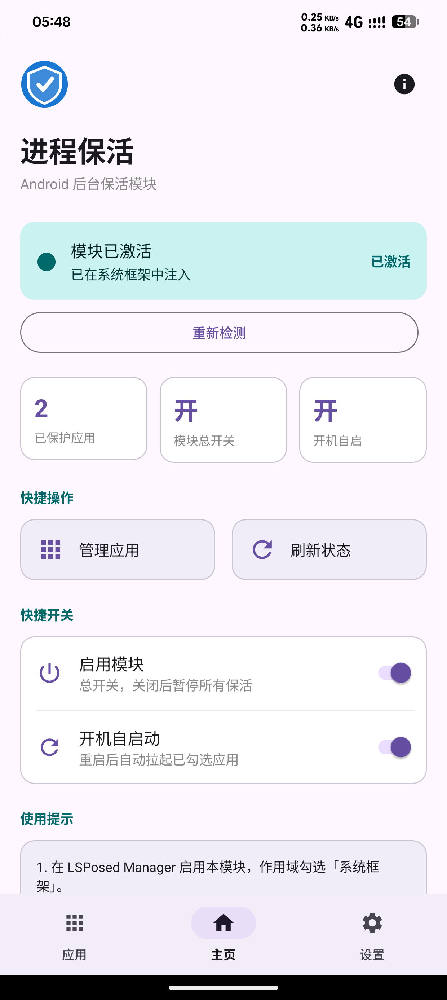
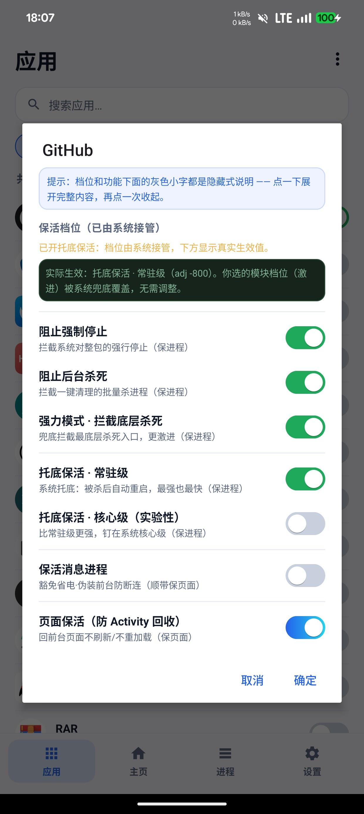
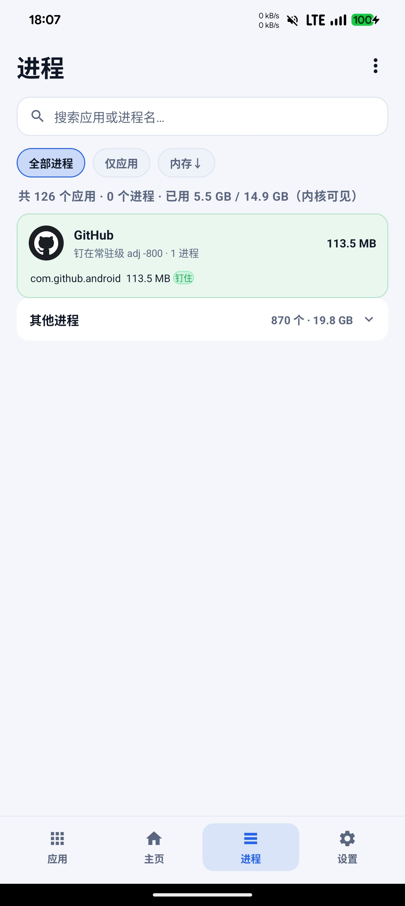
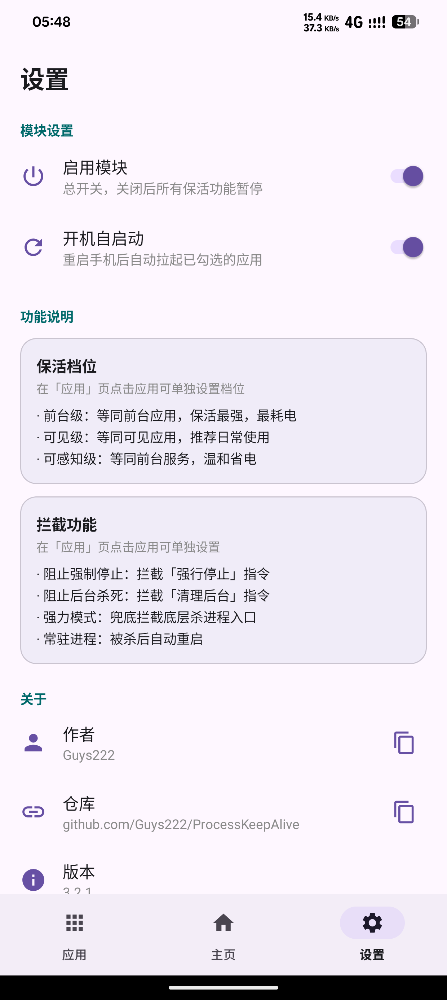

基于 **LSPosed / Xposed** 的 Android 后台保活模块，防止你勾选的应用被系统杀进程（主要面向 LineageOS / AOSP 系）。

简体中文 | [English](https://github.com/Xposed-Modules-Repo/io.github.guys222.processkeepalive/blob/main/README_en.md)

# 进程保活（ProcessKeepAlive）

> 🐛 **问题反馈**：本仓库（LSPosed 收录库）按官方策略未开放 Issues，**请到公开反馈仓库
> [ProcessKeepAlive-Issues](https://github.com/Guys222/ProcessKeepAlive-Issues) 提问或反馈**
> （源码仓库私有维护，不对外开放；Issues 提 Bug，Discussions 提问）。

> ⚠️ 仅限个人设备、自己安装的应用使用。保活会让应用持续占用内存与电量，请勿用于追踪、监控他人设备。

## 安装

在 LSPosed Manager 中搜索「进程保活」安装，或从
[Releases](https://github.com/Xposed-Modules-Repo/io.github.guys222.processkeepalive/releases) 下载最新 APK
（如 `PKA-v3.4.4-build4030.apk`，已用项目专用 keystore 签名，可直接覆盖安装）。

启用后**必须**在 LSPosed 中把作用域勾上「**系统框架（android）**」——所有钩子都注入
`system_server`，不勾这一项模块不工作。

> 可选：同时勾选「本模块」仅用于 App 主页「模块激活状态」的实时检测，不勾不影响保活。

## 界面

底部四页导航：**主页 / 应用 / 进程 / 设置**，支持深色 / 浅色 / 跟随系统三种主题，附带 4×1 桌面小部件。

| 主页 | 应用 | 进程 | 设置 |
| --- | --- | --- | --- |
|  |  |  |  |

- **主页** — 模块激活状态、Bento 概览（守护中 / 运行中 / 消息保活）、24 小时存活曲线（可下钻到单个应用）、守护事件时间线
- **应用** — 搜索与勾选目标应用，每个应用显示真实存活时长与「被杀 / 拉起」次数
- **进程** — system_server 视角的实时进程看板（pid / 状态 / oom_adj / RSS / 运行时长），支持杀进程与导出快照
- **设置** — 各保活能力开关、优先级档位、常驻通知、配置备份与恢复

## 它能做什么

| 能力 | 说明 | 默认 |
| --- | --- | --- |
| 降低 OOM Adj | 把目标进程优先级压低到「可见级」，LMK 不优先杀它 | 开 |
| 阻止强制停止 | 拦截 `forceStopPackage`，设置里的「强行停止」失效（**保进程**） | 开 |
| 阻止后台杀死 | 拦截 `killBackgroundProcesses`（**保进程**） | 开 |
| 强力模式 | 拦截 `ProcessRecord.kill` / `killPackageProcessesLocked`（**保进程·激进**） | 关 |
| 常驻实验 | 把目标进程标记为 `persistent`，被杀后自动重启（**保进程·兜底**） | 关 |
| 消息保活 | Doze/Standby 豁免 + 伪装前台防断连（**保进程**，顺带让界面不被回收） | 关 |
| 页面保活 | 伪装进程为前台 TOP，系统不回收其 Activity（**保页面**） | 关 |
| 开机自启动 | 重启后自动拉起已勾选的应用（system_server 内拉起，绕过后台限制） | 关 |

> **「保进程」和「保页面」是两件事。**
> 除「页面保活」外，所有开关只保证**进程不被杀**——应用回到前台时，界面（Activity）仍可能被
> 系统回收并重新加载，这是 Android 的正常行为。
>
> 「页面保活」通过把进程伪装成前台 TOP 来阻止系统回收 Activity，**只对"由系统主动回收页面"
> 的 ROM 有效**。若应用自己主动调用了 `finish()` 重建界面（如部分 App 检测到后台超时后主动
> 重启自己的页面），框架层面拦不住，此时页面依然会重载。页面能否完整恢复也取决于应用自身
> 有没有保存状态。

## 原理（钩子点）

全部注入 `system_server`（包名 `android`）：

- `ActivityManagerService.forceStopPackage`
- `ActivityManagerService.killBackgroundProcesses`
- `ActivityManagerService.killPackageProcessesLocked`
- `OomAdjuster.computeOomAdjLocked`（Android 11+；老版本回退 `updateOomAdjLocked`）
- `ProcessRecord.kill`
- `ActivityManagerService.newProcessRecordLocked`（常驻实验）
- `ActivityManagerService.finishBooting`（开机自启动）

OOM Adj 只「下调、不上调」：绝不会把正在前台运行的进程优先级调高，避免误伤。

## 重要提示

- **保活不影响应用更新**（v3.3.0 起）：安装/更新前系统必然调用 `forceStopPackage`，
  模块已对安装、替换、卸载以及 root/shell 调用自动放行，不会再出现「保活后装不上新版」。
- **LineageOS 本身不像 MIUI/ColorOS 那样激进杀后台**，本模块主要解决「内存紧张时被 LMK 杀掉」
  和「被强行停止」两类场景，效果不像在国产 ROM 上那么戏剧化。
- **常驻实验有风险**：可能让应用在卸载/更新时异常、崩溃后无限重启、增加耗电，默认关闭。
- **常驻通知需要通知权限**：Android 13+ 首次开启会申请 `POST_NOTIFICATIONS`。
- **Doze/待机**：对开启「消息保活」的应用会自动豁免省电白名单与 App Standby 限流。
- 修改任意设置后约 30 秒自动热刷新，无需重启；长时间不生效再重启系统。

## 验证

```bash
adb logcat -s ProcessKeepAlive                 # 查看模块日志
adb shell "ps -A | grep com.example.app"       # 确认进程存活
adb shell "cat /proc/<pid>/oom_score_adj"      # 值越低越不容易被杀
```

## 更新日志

### v3.4.4（build 4030）

**稳定性**

- 修复开机、切换应用时的系统卡顿与「没有响应」提示：字段查找加入成功/失败缓存，同一字段只反射一次；进程启动标识改用真实存在的字段
- 保活设置关闭后不再被清空，重新开启恢复上次配置；分身恢复自身配置
- 高频的进程结束记录接入缓存，非保活目标不再重复解析

**诊断**

- 运行日志改为落文件，单文件 8MB、轮转保留一份，合计约 16MB；诊断包附带末尾约 2MB
- 每次开机写入分隔行与版本号，便于定位问题所属的开机区间
- 崩溃现场改为提取主线程，不再只取文件末尾
- 系统高负载时仅跳过调用栈采集，日志照常记录

### v3.4.4（build 4028）

**稳定性**

- 修复「批量结束进程」拦截返回空值导致的系统进程异常（严重时整机重启）
- 拦截统一按方法声明类型返回值，杜绝同类拆箱异常
- 非保活进程不再逐个解析包名与 uid，系统调整优先级时的开销大幅下降
- 按 CPU 核数与内存分档，性能有限的设备自动放慢巡检节奏

**保活**

- 页面保活扩展到暂停、停止、窗口不可见三条路径，应用持续认为自己在前后台切换后回到原位，补充状态机路径
- 新增进程重要性查询伪造（getMyMemoryState / getRunningAppProcesses）

**推送**

- 省电白名单 + 待机状态置为活跃，息屏久置消息不延迟
- 系统「是否限制该应用」的查询一律答复未限制，避免应用误判后主动断连

**网络**

- 卡死判定改为流量状态机：先确认正在传输，归零约 36 秒后自动恢复
- WiFi 高性能锁改为按流量持有（原先依赖连接表，多数机型上从未生效）

**拉起**

- 优先选择无副作用的服务，备份/迁移/媒体类仅在别无选择时回退
- 更新与安装期间开窗口让路，不再与安装流程冲突

**诊断**

- 诊断包只带本模块日志，体积从数 MB 降到数百 KB
- 自动附带系统崩溃现场，并标注是否包含本模块
- 文件名带版本与导出时间

### v3.4.4（build 4027）

**后台断网防护重做**

- 防火墙相关钩子此前未生效：类名、方法名与 AOSP 实际实现不符，规则从未被拦下。现按源码逐个核实，重做为五层防线（策略决策 / 执行 / 客户端漏斗 / 查询 / 兜底巡检）。
- 补全 6 条杀进程与冻结路径：批量清理、LRU 回收、进程组终止、Android 15+「不让后台运行」、app freezer，以及两条系统前置查询。
- 补上「应用自查」的四个通道：系统用「是否亮屏 / 是否 Doze / 是否计费网络 / 是否限制后台」告知应用被限制，现只对保活目标伪造。
- 页面保活覆盖状态机路径：此前只拦「被遮挡」两条路径，部分应用走状态机直接路径，现补上三条入口，并保留「用户主动退出不拦」。

**网络与兼容性**

- 下载卡死自动恢复：检测到「有活跃连接但 32 秒零流量」时注入一次网络恢复事件，逼应用重建连接。
- WiFi 高性能锁：联网期间持有，空闲释放。
- 修复 Android 17 上 trimSuppress 被误判「不适用」：类解析改为「类在且方法在」，方法搬家可回落到备选类。

**性能**

- 高频路径接上进程缓存：非目标进程一次查表返回，不再逐个反射。
- 新增设备分档（CPU 核数 + 内存）：自动调整心跳与巡检频率。
- VMA 看护在低端机型默认关闭；找进程改走记账，900 次文件读降为 3 次。

### v3.4.4（build 4025）

**分身保活做全**

- **分身扫描「桌面入口」通道**：双开应用即使从未打开过，也能在「分身应用」页列出并直接勾选保活。
- **修掉「双开应用扫不到」的三个堵点**：用户枚举不返回分身用户、分身用户被 ROM 隐藏、分身用户被 `isCloneProfile` 误排除。
- **主身 / 分身两个页面各有独立的「显示系统应用」开关**：分身页默认只看第三方分身。
- 分身行的系统属性按真实标志判定，不再靠主用户同名应用近似。

**保活强度**

- **页面保活「三保险」**：伪装前台 + 拦截活动进入销毁队列（只拦被遮挡，按返回键正常退出不受影响）+ 抑制系统内存回收信号。
- **进程出生瞬间打标**：进程记录诞生的那一刻就写入常驻 / 核心级标记。

**性能（针对「安装模块后手机变卡」）**

- 心跳进程扫描改为直接读系统内存中的进程列表，不再每 4 秒遍历 /proc 读几百个进程；
- 全量进程扫描改为自适应节奏（机器越快刷新越勤，最快 2 秒）；
- 分身扫描改为 2 分钟兜底 + 打开分身页 / 下拉刷新时即时扫描；
- 高频调用路径减负：已确认非目标的进程一次查表即返回。

**修复**：设置页长按复制无效（诊断包 / 备份恢复等行）、分身扫描通道互相连坐、分身键退化成主包名、合成内存回收与页面保活目标相反、配置弹窗黑边。

- 版本号 3.4.3 → 3.4.4，versionCode 4024 → 4025，签名不变可直接覆盖安装；更新后需重启一次系统让新钩子生效。

### v3.4.3（build 4017）

- **修复桌面图标隐藏问题**：「设置 → 桌面 → 隐藏桌面图标」开启后，桌面图标彻底消失、不可点击（不再残留旧图标、点击不再跳应用信息页）；隐藏后拨号盘输入 `*#*#888#*#*` 直接唤起 App（无需重启）；取消隐藏后图标立即恢复、可正常点击打开。

### v3.4.3（build 4014）

- **★ 开机自连**：重启后无需手动打开本 App，主页也能即时显示已激活（system_server 装好钩子即直写激活标记）
- 激活自愈重连：上报重试 1440 次后永久放弃 → 改为永不放弃长间隔重试，App 一上线即连
- 能力自检新增「不适用」态：澎湃 / Android 14 无 `batchSetOomAdj` 不再误红，仍全绿
- 死亡原因精细化：区分「系统低内存回收 / 应用崩溃 / 自行退出」
- 映射槽位显示应用名（Termux 等不再显示成 `com.termux`）
- 系统限制徽章改橙红底，命中即醒目
- 映射槽位残留双层修复（钩子裁剪 + App 过滤）

### v3.3.0（versionCode 3）

- **全新界面**：重做为完整应用，底部四页导航「主页 / 应用 / 进程 / 设置」。
- **主页仪表盘**：激活状态、Bento 概览、**24 小时存活曲线**（自绘折线，可点应用图标下钻）。
- **进程页**：按应用分组展示 `pid / 状态 / oom_adj / RSS / 运行时长`，支持杀进程与导出快照。
- **守护事件时间线**：倒序记录「被杀 / 拉起 / 开机拉起」三类事件。
- **配置备份与恢复**、**常驻通知**、**4×1 桌面小部件**、**深色模式**。
- **页面保活**：新增开关，把进程伪装为前台以阻止系统回收 Activity。
- **修复**：保活应用无法安装/更新的问题（对安装与 root/shell 调用放行）。
- 版本号重置为「versionCode-versionName」小号方案（**3-3.3.0**）；此前装过 4000/4001 测试版的用户需手动重装一次。

### v3.2.2（versionCode 33）

- 包名由 `com.processkeepalive` 改为 `io.github.guys222.processkeepalive`。已装旧版的用户
  升级后会被视为新模块，需重新勾选作用域并重启。

## 打赏

如果这个模块帮到了你，欢迎给个 Star ⭐


## 许可

本项目仅供个人学习与自用设备使用。
