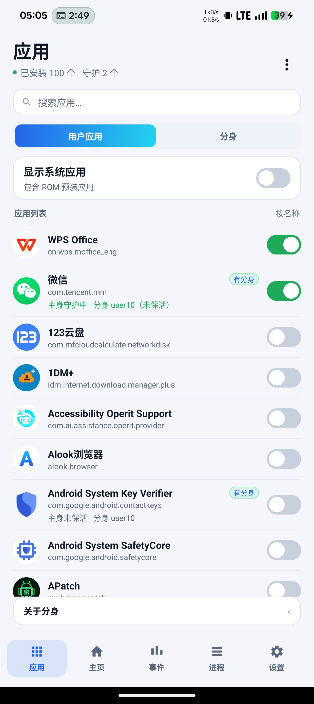
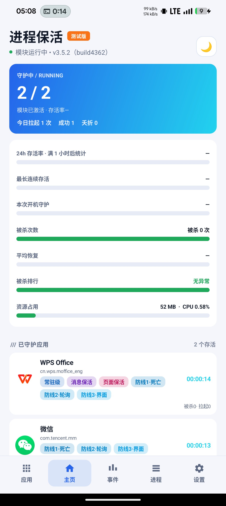
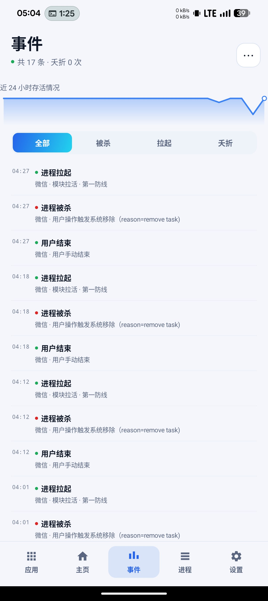
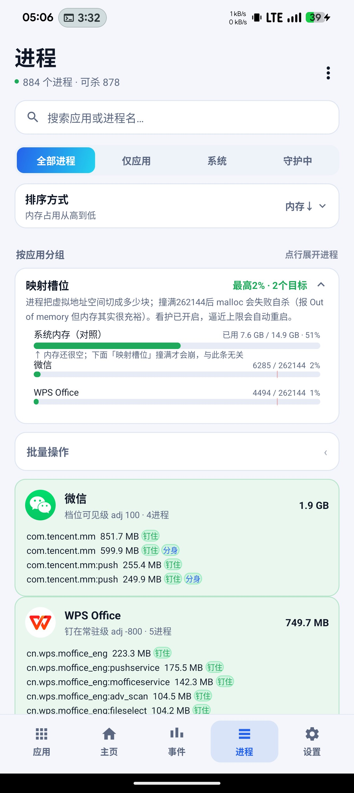
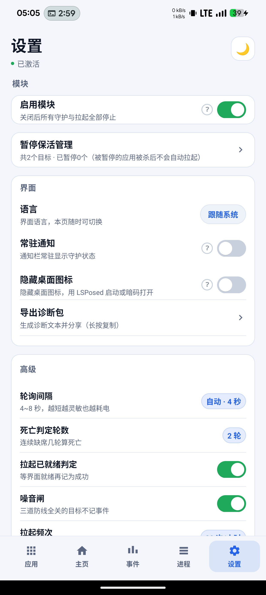

[简体中文](https://github.com/Xposed-Modules-Repo/io.github.guys222.processkeepalive/blob/main/README.md) | English

# ProcessKeepAlive (进程保活)

> 🐛 **Feedback / Issues**: this repo (the LSPosed module listing) has Issues disabled per the
> listing's policy — **please post on the public feedback repo
> [ProcessKeepAlive-Issues](https://github.com/Guys222/ProcessKeepAlive-Issues)**
> (the source repo is private; use Issues for bugs, Discussions for questions). Replies are usually fast.

An LSPosed / Xposed-based Android background keep-alive module, mainly targeting **LineageOS (AOSP-based)** ROMs. It hooks into `system_server` to intercept the system's kill behaviour, so selected apps are not killed by the Low Memory Killer (LMK) or by "Force stop".

> ⚠️ For personal devices and your own apps only. Keep-alive keeps apps occupying memory and battery — do not use it to track or monitor others' devices.

## Install

Search for "进程保活" in LSPosed Manager, or download
the latest APK (e.g. `PKA-v3.6.0-build4428.apk`) from [Releases](https://github.com/Xposed-Modules-Repo/io.github.guys222.processkeepalive/releases)
(signed with the project's own keystore, installs over previous builds).

Every release ships **two** files; they are functionally identical:

- `PKA-v<version>-build<num>.apk` — the normal build, for everyone;
- `PKA-v<version>-build<num>-debug.apk` — **install this one if you have a problem**: on white
  screen, ANR (hang) or a failed relaunch it saves the scene to `/data/system/pka_hook.log`,
  which goes into the diagnostics package. Same key, they install over each other.

**Reboot after installing** — hooks live in the system framework; until then the old code runs.

After enabling the module you **must** tick the "**System framework (android)**" scope in LSPosed — all hooks are injected into `system_server`, and nothing works without it.

> Optional: also ticking the module itself is only used for the live "module activated" indicator on the home tab. It does not affect keep-alive.

## UI

Five bottom tabs: **Apps / Home / Events / Processes / Settings**, with dark / light / follow-system themes and a 4×1 home-screen widget.

| Apps | Home | Events |
| --- | --- | --- |
|  |  |  |

| Processes | Settings |
| --- | --- |
|  |  |

- **Events** — guard event timeline (killed / relaunched / died young / user-stopped) with type
  filters, CSV export by long-pressing refresh, and a 24-hour survival sparkline.

| Home | Apps | Processes | Settings |
| --- | --- | --- | --- |
|  |  |  |  |

- **Home** — activation status, Bento overview (guarded / running / message keep-alive), 24-hour survival chart (tap an app to drill down), guard event timeline
- **Apps** — search and tick target apps; each shows real uptime plus kill / relaunch counters
- **Processes** — live `system_server` process board (pid / state / oom_adj / RSS / uptime), with kill and snapshot export
- **Settings** — individual keep-alive capability switches, priority level, persistent notification, config backup & restore

## What it does

| Capability | Description | Default |
| --- | --- | --- |
| Lower OOM adj | Drops target processes to the "visible" adj so LMK won't kill them first | On |
| Block force stop | Hooks `forceStopPackage`, so "Force stop" does nothing (**process keep-alive**) | On |
| Block background kills | Hooks `killBackgroundProcesses` (**process keep-alive**) | On |
| Aggressive mode | Hooks `ProcessRecord.kill` / `killPackageProcessesLocked` (**process · aggressive**) | Off |
| Persistent experiment | Marks targets `persistent` and restarts them after a kill (**process · fallback**) | Off |
| Message keep-alive | Doze/Standby exemption + fake foreground to avoid dropped connections (**process**, also helps the UI survive) | Off |
| Page keep-alive | Fakes the process as foreground TOP so the system won't recycle its Activities (**page**) | Off |
| Boot auto-start | Relaunches ticked apps after reboot (launched inside `system_server`, bypassing background limits) | Off |

> **"Keep the process alive" and "keep the page alive" are two different things.**
> Every switch except "Page keep-alive" only guarantees that the **process** is not killed — when the
> app returns to the foreground, its UI (Activity) may still be recycled by the system and reloaded.
> That is normal Android behaviour.
>
> "Page keep-alive" fakes the process as a foreground TOP app to stop the system from recycling
> Activities, and **only works on ROMs where the system itself recycles the page**. If an app
> calls `finish()` on its own Activities (some apps restart their UI after detecting a background
> timeout), that happens at the app level and cannot be intercepted by a framework hook — the page
> will still reload. Whether the state is fully restored also depends on the app saving it.

## How it works (hook points)

All hooks are injected into `system_server` (package `android`):

- `ActivityManagerService.forceStopPackage`
- `ActivityManagerService.killBackgroundProcesses`
- `ActivityManagerService.killPackageProcessesLocked`
- `OomAdjuster.computeOomAdjLocked` (Android 11+; falls back to `updateOomAdjLocked` on older releases)
- `ProcessRecord.kill`
- `ActivityManagerService.newProcessRecordLocked` (persistent experiment)
- `ActivityManagerService.finishBooting` (boot auto-start)

OOM adj is only lowered, never raised — foreground processes are never promoted, so nothing gets broken by accident.

## Notes

- **Keep-alive no longer blocks app updates** (since v3.3.0): the system always calls `forceStopPackage`
  before installing or updating. The module now exempts install / replace / uninstall as well as
  root and shell callers, so guarded apps can be updated normally.
- **LineageOS doesn't kill background apps as aggressively as MIUI/ColorOS.** This module mainly
  targets "killed by LMK under memory pressure" and "force-stopped" scenarios, so the effect is less
  dramatic on some Chinese ROMs.
- **The persistent experiment is risky**: it may break uninstalls/updates or cause endless restarts
  after a crash, and it drains battery. Off by default.
- **The persistent notification needs notification permission**: Android 13+ asks for
  `POST_NOTIFICATIONS` the first time you enable it.
- **Doze / standby**: apps with "Message keep-alive" enabled are automatically exempted from the
  power-save whitelist and App Standby bucket restrictions.
- Any setting change hot-refreshes within ~30 seconds — no reboot needed. Reboot only if it doesn't
  take effect for a long time.

## Verify

```bash
adb logcat -s ProcessKeepAlive                 # module logs
adb shell "ps -A | grep com.example.app"       # is the process alive
adb shell "cat /proc/<pid>/oom_score_adj"      # lower = less likely to be killed
```

## Changelog

### v3.6.0 (build 4428)

**Process keeping**

- **First launch after reboot crashed (second launch fine)**: the launcher-icon calibration set the package enabled on every start without `DONT_KILL_APP`, so the system killed the running process. It now reads the current state first and skips the write when it already matches.
- **"Boot start" did nothing**: previously the polling defense pulled every target ~40-50 s after boot regardless. Targets that have not run since boot and do not have "Boot start" enabled are now left alone; normal guarding resumes after you open them once. (Resident alone no longer implies boot start.)
- **Killed after being frozen**: cause was `Sync transaction while frozen`. Only `freezeAppAsync` was intercepted; the real sink `ProcessList.setProcessFrozen` is now hooked too, and processes carrying the persistent flag are treated as protected (covers the window before config loads at boot).
- **Orphan-record guard fully broken on merged-class ROMs**: those ROMs merge AMS and ATMS into one class, while the code still looked for ATMS inside AMS. The AMS instance is now reused directly.
- **White screen when reopening a killed app**: the page-keeping hook blocked "go to background / finish", assuming the record could bring the page back. Once the process dies the record is a shell — still registered, but nothing can draw into it. Opening the app reused exactly that shell. Now only live processes keep their pages.
- **App list empty when the ROM denies "read installed apps"**: hooks run in system_server and are unaffected, but the UI is a normal app. system_server now enumerates the list and pushes it with the heartbeat.
- **Guard badges incomplete**: added "Boot start / Respect manual kill / Card lock / Paused". "Paused" was the worst — paused apps are no longer pulled or intercepted, yet the list still showed all capabilities. A paused app now shows a single grey "Paused" badge.
- **App icons looked clipped**: adaptive icons only draw a square base; the launcher is supposed to mask them. Inserted directly into an ImageView they exposed right angles. Now masked to 25% rounded corners and the asset's own transparent padding is trimmed.

**Events page rebuilt**

- **Full causal chain**: tapping any event shows every event for that app since boot, connected in time order, with the tapped one highlighted; a "boot + interval" node is prepended when the chain starts before boot.
- **Grouped by app**: the four type filters became "All / each target" with icon and count. With a causal chain, filtering by type is redundant.
- **Each event carries its own raw log**: 2-3 related lines (filtered by package name), up to 400 chars, newlines preserved, truncated only at line boundaries.
- **Descriptions split into paragraphs**: long explanations broken into conclusion / two possibilities / how to narrow it down, with spacing.

**UI**

- **All dialogs became bottom sheets**: slide up from the bottom, rounded top, grabber and scrim, animated.
- **Guarded-app detail redesigned**: 13 switches no longer fit on one screen, so it is split into Overview / Strategy / Capabilities tabs. Each switch shows a top countdown hint after toggling.
- **Switch colour unified to green** (was a mix of green and blue).
- **The dialer code no longer rewrites the "hide launcher icon" switch**; after toggling visibility system_server sends `PACKAGE_CHANGED` so the launcher refreshes.
- **Removed duplicated panels**: home "guarded this boot", home "kills / avg recovery" bars, app-dialog "recent events", dialog "kill reason distribution", summary "recent boots".

**Diagnostics**

- **Hang watchdog (debug builds only)**: samples each target's main thread every 5 s — `D` state for 10 s (IO hang), `R` without CPU progress for 20 s (busy loop), or 5 s of unhandled input. A snapshot is written on hit.
- **A "resident at boot" event is now recorded** on the first persistent mark; the empty state also explains that resident alone does not pull at boot.
- **Log hygiene**: freeze skip buckets summarised by reason every 10 minutes; per-line cap 400 chars, filtered by package, newlines preserved.

**Updates**

- **Fixed "update downloaded the debug APK"**: with both APKs in a release, `-debug.apk` sorts first alphabetically and the first match was taken. The release build is now preferred.
- **The update debug panel is gone from release builds**: it was triggered by tapping the version row five times and had a hard-coded old tag, which could reinstall a historic version. Debug builds only now, with a dynamic tag.

**About "card lock"**

Behaviour matches build 4363: a locked card cannot be swiped away — it bounces back and the page is kept. This version does not make the card disappear after swiping; several approaches failed on real devices, so it is left as-is rather than shipping a half-working feature.

### v3.5.2 (build 4363)

- **Fixed white screen.** Screen keep-alive kept an ActivityRecord whose host process was gone;
  that record is an empty shell — the window is created but nothing can draw into it, and the
  system reuses it when you tap the icon. Keep-alive now only keeps records whose process is alive.
- **Fixed "app stays in the foreground after being pulled back".** The old guard ("skip sending
  back if the UI is ready") was always true, because the wait loop only exits once the UI is ready.
- **4th relaunch route** (`ProcessList.startProcessLocked`): correct class and arguments; gives up
  quietly on ROMs that do not support it.
- **Log size**: freeze diagnostics now aggregate per reason, once per 10 minutes.
- **debug build**: target-app ANR now auto-captures the scene.

### v3.5.0 (build 4232)
**New features**

- **Per-app overrides for the three relaunch lines**: boot relaunch / post-death relaunch / polling fallback can now be toggled separately for each app. Apps you never touched keep following the global default. Cloned and main instances are fully independent
- **Pull-died events**: if a target dies again during the post-launch verification window, the event feed records "relaunch died · line X (attempt N)" instead of failing silently
- **Configurable polling interval**: 4 / 6 / 8 seconds, or automatic. Shorter is more responsive and drains more battery
- **Configurable death threshold**: 1 to 5 consecutive missed polls before a target counts as dead (default 2). Persistent / core targets stay fixed at 1 round
- **Noise gate**: targets with all three relaunch lines disabled no longer generate event records at all
- **Auto-mute for "dies right after launch"**: three consecutive relaunches that survive less than 30 seconds each pause that event type until the app starts surviving again
- **Events moved to their own page**: the event feed is now a dedicated tab with type filters instead of sitting at the bottom of the home page
- **Termination exemption is now permanent**: swiping the card away, force-stopping or one-tap cleanup stops relaunching for that app with no 60-second window and no automatic resume — keep-alive resumes only when you reopen the app. A “auto-relaunch paused” event marks it in the feed

**Bug fixes**

- **Home page reported a successful relaunch, but opening the app was a cold start**: the old check was "any process of the package is alive", and Provider-triggered relaunches frequently bring up only sub-processes such as `:remote` or `.fp` while the main process never starts. The check now requires the main process; sub-process-only states are recorded as an incomplete relaunch and retried
- **Relaunched apps vanished a moment later with nothing following up**: success used to be recorded the instant the launch intent was issued, so a kill during the cold-start window went unnoticed. Launches are now only registered as pending and confirmed after three verification rounds (5s / 8s / 12s) observe a continuously alive main process
- **After one kill the app needed a manual launcher tap to come back**: same root cause — with no main process there is no death callback, so the first line of defence silently stopped working. Fixed together with the main-process check
- **Per-clone defence settings were overridden by the main package**: when the userId could not be parsed the override lookup fell back to the main package's config, so a clone's independent settings were ignored. The two are now completely separate with no fallback
- **Pause-keepalive did not actually pause**: paused packages merely disappeared from the list while the module kept relaunching, intercepting and logging them. Paused packages are now excluded from the delivered target set, so the module never touches them
- **A manually swiped-away target came back 60 seconds later**: the old exemption expired after 60s and relaunching resumed on its own. The exemption is now permanent and only you reopening the app restores keep-alive

**UI polish**

- Overall layout reworked, with clearer visual distinction between the on and off states of the switches
- Section rows, helper text and the help-dot widget now share consistent alignment and spacing
- The pause-keepalive manager is now a dialog, with app icons, status subtitles and separators added to the list

### v3.4.5 (build 4095)

**New features**

- **Three independent relaunch switches**: boot relaunch / post-death relaunch (first line of defence) / polling fallback (second line of defence) can now be toggled separately. Turn all three off and the module only protects processes without ever launching them — for users who want to hand relaunching over to the system or a third-party scheduler
- **Master switch narrowed in scope**: now a pure module on/off switch, no longer coupled to relaunch behaviour
- **Activity-fallback relaunch returns to background automatically**: the third relaunch path no longer leaves the target app in the foreground; it is sent back to the background right after launch
- **Self-probing and caching of reflection paths**: on boot the module probes which AMS / ATMS / RootWindowContainer / Task send-to-back paths actually work on this ROM and caches the result — no rebuild needed for other ROMs
- **Side-effect disclosure dialog**: enabling the activity fallback now explains up front that it will briefly bring the target to the foreground; it only takes effect after confirmation. Cancelling, pressing Back, or tapping outside all revert the toggle
- **Diagnostic logging behind a switch**: off by default, enabled on demand when troubleshooting
- **Live self-test progress**: the self-test dialog now shows phase text and a progress bar with elapsed seconds instead of static text
- **Failed relaunches are recorded as guard events**: the UI timeline now shows "relaunch failed · line X" instead of failing silently

**Bug fixes**

- **Cold-start relaunch not working**: the relevant service instances were only assigned inside the force-stop hook and were null right after boot, so the first line of defence did nothing; now resolved on demand and cached
- **Send-to-back failing repeatedly**: three unusable private framework paths were ruled out one by one; `Task.moveTaskToBack(Task)` was confirmed to work
- **Boot events lost for always-on apps (e.g. WeChat)**: the criterion changed from "did the user tick it" to "does the process actually carry the persistent flag", removing false negatives
- **Some compatibility paths inevitably fail on Android 17**: that release merged the two framework services into a single class; the module now reads the field directly from the merged class while keeping the old path for older versions
- **Field lookup hitting an inner class by mistake**: name-based matching could land on a Handler inner class; inner classes are now excluded and a fallback scan was added
- **Dialog confirm button pushed off-screen**: restored, with height-limited scrolling
- **Scenario preset chips appearing visually sunken**: geometry aligned between states

### v3.4.4 (build 4033)

**Keep-alive**

- Again fixed "returning to the home screen bounces back to the app": removed the interception that blocked the activity state from entering STOPPING
- Page keep-alive now keeps only the addToStopping layer: the state machine completes normally, the system does not destroy the page, and returning shows the same page
- State now matches real visibility, so the launcher no longer gets pushed away right after appearing

### v3.4.4 (build 4031)

**Keep-alive**

- Fixed "pressing Home automatically jumps back to the kept app": removed the interceptions on PAUSED (focus loss) and window visibility; page keep-alive only keeps "do not enter STOPPING"
- Result: you can switch to the home screen normally and come back to the same page without reloading, with background work uninterrupted

### v3.4.4 (build 4030)

**Stability**

- Fixed system jank and "not responding" prompts during boot and app switching: field lookups now cache success and failure, so each field is reflected only once; the process start marker now uses a field that actually exists
- Keep-alive settings are no longer cleared when the feature is turned off; re-enabling restores the previous configuration; cloned apps restore their own configuration
- High-frequency process-exit records are cached; non-target processes are no longer re-parsed

**Diagnostics**

- Runtime logs now go to file: 8 MB per file, one rotated copy kept, ~16 MB total; diagnostic bundles include the last ~2 MB
- A separator line and version number are written on every boot so issues can be attributed to a boot session
- Crash snapshots now extract the main thread instead of just the tail of the file
- Under high system load only stack collection is skipped; logging continues

### v3.4.4 (build 4028)

**Stability**

- Fixed the "batch kill processes" interception returning null, which could crash system processes (and reboot the device in severe cases)
- Interceptions now return values according to the declared method type, eliminating unboxing exceptions of the same kind
- Non-kept processes are no longer resolved package name and uid one by one, greatly reducing overhead when the system adjusts priorities
- Tiers by CPU cores and memory: low-end devices automatically slow down their polling cadence

**Keep-alive**

- Page keep-alive extended to pause, stop and window-invisible paths
- Added process importance query spoofing (getMyMemoryState / getRunningAppProcesses)

**Push**

- Battery-optimisation whitelist plus standby state set to active, so messages are not delayed during long screen-off periods
- All "is this app restricted" queries answer "not restricted" so apps do not drop connections on their own

**Network**

- Stalled-download detection reworked into a flow state machine: confirm transfer first, auto-recover ~36 s after traffic drops to zero
- Wi-Fi high-performance lock now held based on traffic (the previous connection-table approach never took effect on most devices)

**Relaunch**

- Prefers side-effect-free services; backup / migration / media services only as a last resort
- Opens a window during updates and installs so they no longer conflict

**Diagnostics**

- Diagnostic bundles now include only this module's logs, shrinking from several MB to a few hundred KB
- System crash snapshots are attached automatically, marked whether they include this module
- File names include version and export time

### v3.4.4 (build 4027)

**Background network protection reworked**

- Firewall hooks previously never took effect: class names and method names did not match the real AOSP implementation, so rules were never applied. Verified against source and rebuilt as a five-layer defence (policy decision / execution / client funnel / queries / fallback patrol)
- Added 6 process-kill and freeze paths: batch cleanup, LRU reclaim, process group termination, Android 15+ "no background running", app freezer, and two system pre-checks
- Added the four self-check channels by which the system tells apps they are restricted (screen on / Doze / metered network / background restricted); now only spoofed for kept targets
- Page keep-alive now covers state-machine paths: previously only the two "obscured" paths were intercepted; three more entry points were added, while "user-initiated exit is not intercepted" is preserved

**Network and compatibility**

- Stalled-download auto recovery: when an active connection has zero traffic for 32 s, a network recovery event is injected to force the app to rebuild the connection
- Wi-Fi high-performance lock: held while networked, released when idle
- Fixed trimSuppress being wrongly reported "unsupported" on Android 17: class resolution now requires "class present and method present", with fallback classes

**Performance**

- High-frequency paths use the process cache: non-target processes return from one table lookup instead of repeated reflection
- Added device tiering (CPU cores + memory) to auto-adjust heartbeat and patrol frequency
- VMA watch disabled by default on low-end devices; process lookup now uses bookkeeping, cutting 900 file reads down to 3

### v3.4.4 (build 4025)

**Cloned-app (dual app) support completed**

- **Launcher-entry scan channel**: cloned apps no longer need to be running — installed but
  never-launched clones are listed and can be enabled directly.
- **Fixed "cloned apps not found"** (three causes): user enumeration skipping pre-created clone
  users, ROMs hiding the clone user, clone users wrongly excluded by `isCloneProfile`.
- **Separate "Show system apps" switch per tab** (main / clone); clone tab defaults to
  third-party clones only.
- Clone rows now use the real system flag instead of approximating from the main-user package.

**Keep-alive strength**

- **Page keep-alive "triple safeguard"**: fake foreground + block activities from entering the
  destroy queue (only when obscured — pressing Back still exits normally) + suppress the system's
  memory-reclaim signal.
- **Stamp at process birth**: persistent / core markers are written when a process record is created,
  closing the window before the system first computes its priority.

**Performance** (addressing "phone got laggy after installing the module")

- Heartbeat scan reads the in-memory process list instead of walking /proc every 4 seconds;
- Full process scan uses an adaptive interval (faster machines refresh sooner, down to 2s);
- Clone scan is on-demand (2-minute fallback + immediate scan on pull-to-refresh);
- High-frequency hook path: confirmed non-target processes return after a single map lookup.

**Fixes**: long-press copy in Settings, clone scan channels failing each other, clone keys degrading
to the main package, synthetic memory reclaim conflicting with page keep-alive, config dialog black bar.

- Version 3.4.3 → 3.4.4, versionCode 4024 → 4025; same signature, overwrite install works.
  Reboot once after updating so the new hooks take effect.

### v3.4.3 (build 4017)

- **Fixed desktop icon hiding**: with "Settings → Desktop → Hide desktop icon" on, the icon now fully disappears and is non-clickable (no leftover icon, no jump to App info); while hidden, dial `*#*#888#*#*` to relaunch the app (no reboot needed); un-hiding restores the icon immediately and clickable.

### v3.3.0 (versionCode 3)

- **Brand-new UI**: reworked into a complete app with four bottom tabs — Home / Apps / Processes / Settings.
- **Home dashboard**: activation status, Bento overview, **24-hour survival chart** (custom-drawn line
  chart, tap an app icon to drill down).
- **Processes tab**: grouped by app, showing `pid / state / oom_adj / RSS / uptime`, with kill and
  snapshot export.
- **Guard event timeline**: reverse-chronological "killed / relaunched / boot relaunched" events.
- **Config backup & restore**, **persistent notification**, **4×1 widget**, **dark mode**.
- **Page keep-alive**: new switch that fakes the process as foreground to stop Activity recycling.
- **Fix**: guarded apps could not be installed or updated (install and root/shell callers are now exempted).
- Version scheme reset to the compact "versionCode-versionName" style (**3-3.3.0**); users who installed the 4000/4001 test builds need to reinstall once.

### v3.2.2 (versionCode 33)

- Package renamed from `com.processkeepalive` to `io.github.guys222.processkeepalive`. Existing installs
  are treated as a new module — re-tick the scope and reboot.

## Donation

If this module helped you, feel free to give it a Star ⭐


## License

Personal learning and self-use devices only.
